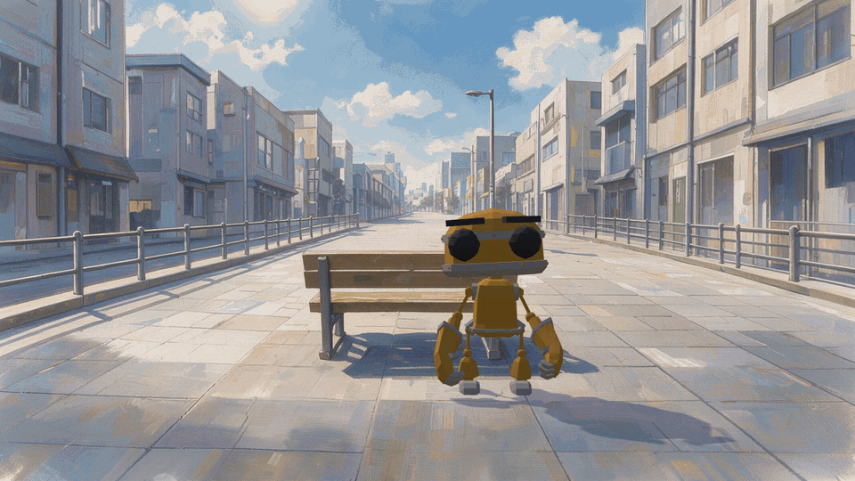

# backdrop

A walkable painted background in three.js. A 2D painted plate is the scene; a camera matched to the painting, invisible proxy geometry and a walkable area let a 3D character walk in it, behind objects, up stairs and between maps.

Live demo: https://wally869.github.io/backdrop/



Video: [media/backdrop.mp4](media/backdrop.mp4)

## Controls

- Click: walk to the point.
- Double-click: run to the point.
- W/A/S/D or arrow keys: walk relative to the camera. Hold Shift to run.
- Click the bench (first map): sit.
- G: debug view (proxies, walkable area, markers).
- M: music on/off.
- H: show the controls again.

Walk to the far end of a map to go to the next one. To open a map directly, add `?map=plate_02` or `?map=plate_03` to the URL.

## Run locally

```
npm install
npm run dev
```

Then open the URL that vite prints. `npm run build` makes the static site in `dist/`.

## Credits

Character: RobotExpressive by Tomas Laulhe (CC0 1.0), modifications by Don McCurdy. See `public/models/RobotExpressive.README.md`.
